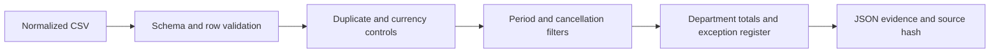

> **Proprietary - All Rights Reserved.** Licensed to Sandeep Grover. No reuse, copying, modification, or distribution without prior written permission. See LICENSE.

# Operational Reporting Audit

Synthetic KPI controls before a dashboard refresh. Validates a normalized CSV, quarantines all duplicate-ID members, prevents currency mixing, applies inclusive reporting cutoffs, and reconciles row counts. No client data, credentials, paid APIs or external connections.



## Run
Python3.10+; runtime standard library only. Execution/reuse requires permission under LICENSE.
```bash
python -m venv .venv
. .venv/bin/activate
pip install -r requirements.txt
python main.py --input data/operations.csv --output audit.json
python -m pytest -q
```

The deliberately defective synthetic input has nine rows: four accepted, three quarantined and two excluded. Accepted booked USD value is3,000 (Sales2,000; Services1,000). Duplicate IDs are all quarantined; EUR is not converted. Cancelled/out-of-period rows are separately excluded. Release status remains `review_required` while exceptions exist.

## Definition and limitations
Booked USD value sums noncancelled, valid, unique records inside the inclusive date range. It is not cash collected, accounting revenue or profit. No amount is imputed.

One normalized input only: no live CRM/database connector, BI deployment, access controls, scheduler, late-arrival restatement or full accounting reconciliation. Real work requires agreed source ownership, business definitions, authoritative IDs, refresh SLAs and platform selection. Exceptions require owner review. All records are invented; this is new sample work, not a prior client deliverable.
